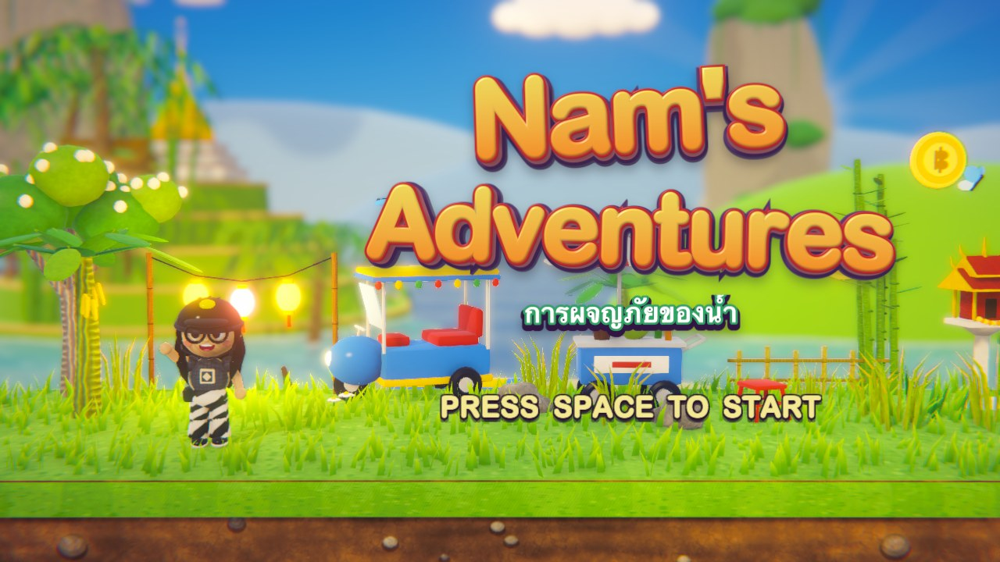
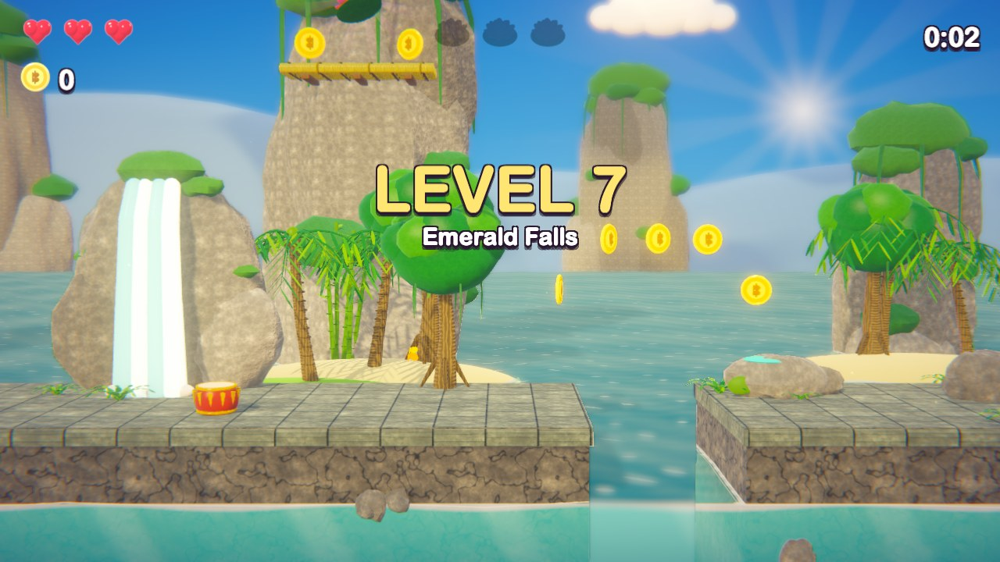
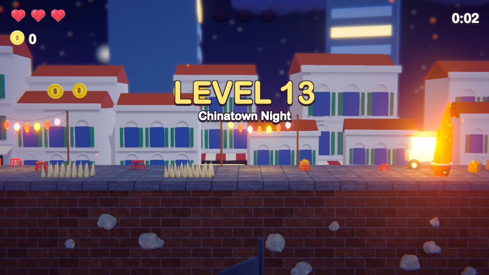
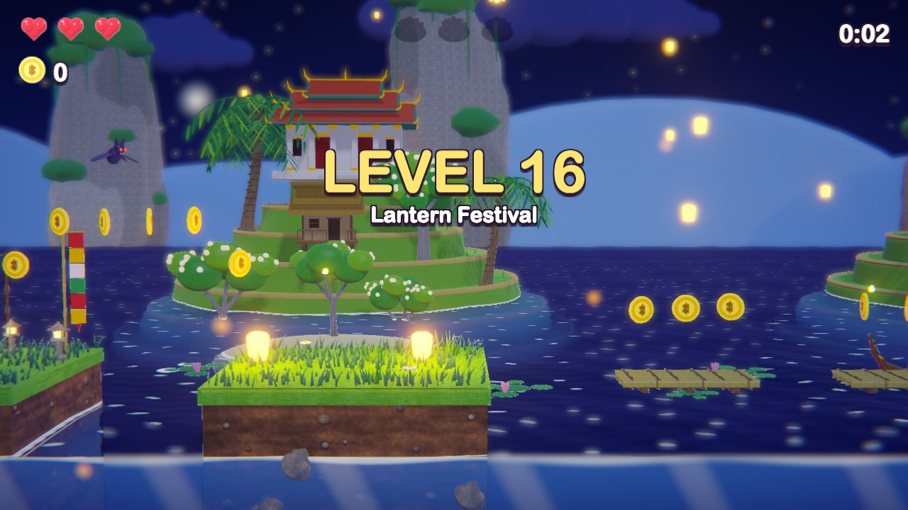
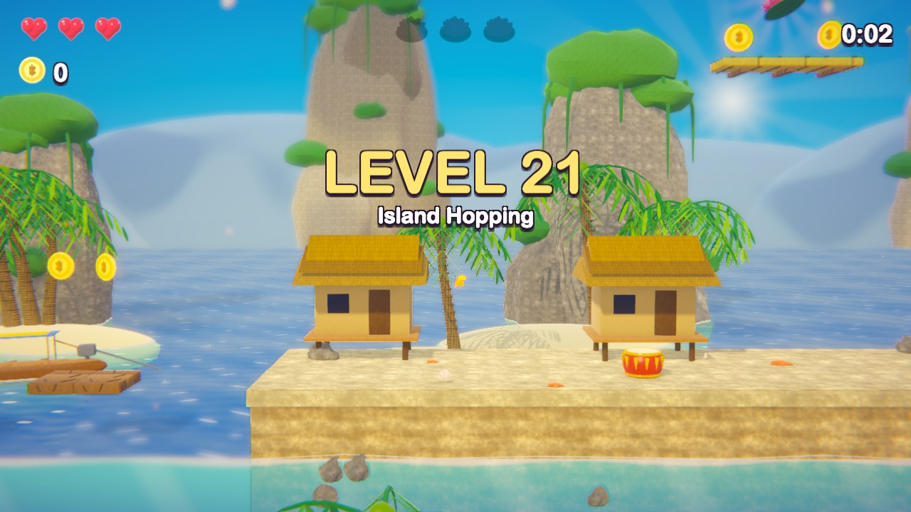
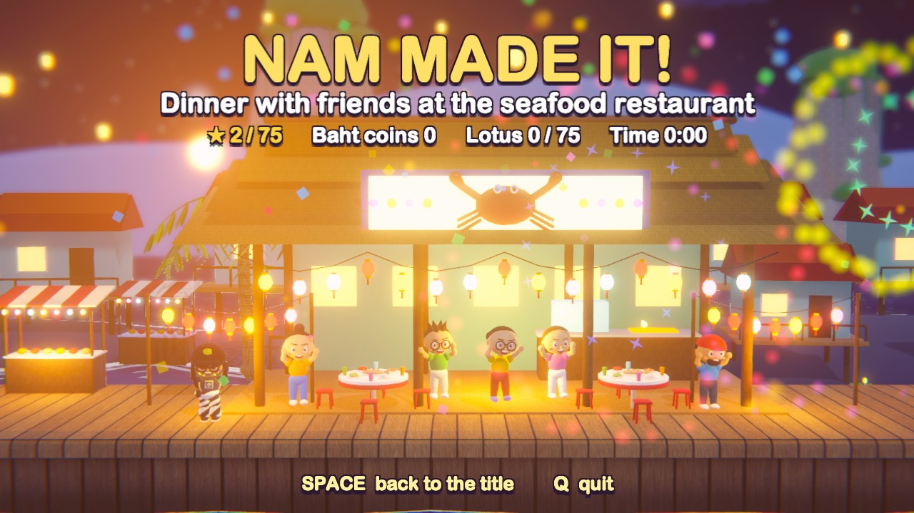

# Nam's Adventures

A Thai-themed 2.5D jump-and-run platformer for macOS, built with Unity and rendered with Metal.

Nam is on her way to dinner. Twenty-five levels lie between her and the seafood restaurant where her friends are waiting: rice paddies, floating markets, bamboo forests, Bangkok rooftops, lantern festivals, limestone islands and a night market by the sea.



| | |
|---|---|
|  |  |
|  |  |



## Play

Download `Nams-Adventures-macOS.zip` from the [latest release](https://github.com/lydianb79/Nam-s-Adventures/releases/latest), unzip it and open **Nam's Adventures**.

The app is not notarized by Apple. The first time, right-click the app and choose **Open**, then confirm. It needs macOS 12 or later and runs natively on Apple Silicon.

## Controls

| Action | Keyboard | Gamepad |
|---|---|---|
| Move | A / D or ← / → | Left stick or D-pad |
| Jump | Space, W or ↑ | A / ✕ |
| Duck, slide, drop through bamboo platforms | S or ↓ | D-pad ↓ |
| Run | Shift | X / □ or RT |
| Fire (with chili) | X or J | B / ○ |
| Pause | P | Start |
| Leave full screen | Esc | |

On the title screen, ← and → choose any level you have reached.

Everything is configurable under **Nam's Adventures ▸ Settings…** (⌘,): keyboard and gamepad bindings, fullscreen resolution, window size, render quality (up to 2× supersampling), music and effects volume, and whether the game starts in full screen. **View ▸ Enter Full Screen** is ⌘F.

## The game

- **25 levels**, each with its own scenery, lighting, weather, enemies and music, getting longer and harder.
- **Power-ups**
  - *Som Tam*: restores a heart and gives a mid-air double jump.
  - *Chili*: spit bouncing fireballs.
  - *SangSom*: a short unstoppable rush that is faster, jumps higher and knocks out enemies on contact.
  - *Mango*: restores a heart.
- **Per level**: two checkpoints, three hidden lotus flowers, baht coins, and a star rating for the best run.
- **Moves**: variable-height jump, run, duck, slide, wall push, and a somersault on the double jump.
- **Soundtrack**: 27 pieces in Thai 7-step tuning for Thai ensemble instruments (ranat, khong wong, pi, khim, saw, phin, khaen, drums), plus matching sound effects.
- **The ending**: fireworks, lanterns and a cheering crowd at the restaurant.

### Levels

1 Paddy Field Dash · 2 Banana Grove · 3 Floating Market · 4 Bamboo Forest · 5 Elephant Trail · 6 Tea Hills · 7 Emerald Falls · 8 Sunflower Fields · 9 Monkey Temple · 10 Durian Orchard · 11 Railway Market · 12 Bangkok Rooftops · 13 Chinatown Night · 14 Songkran Splash · 15 Ayutthaya Dusk · 16 Lantern Festival · 17 Loy Krathong · 18 Cave of Light · 19 Mangrove Maze · 20 Monsoon Run · 21 Island Hopping · 22 Coral Beach · 23 Fishing Village · 24 Night Market · 25 Seafood Road

## How it is made

Everything in the game is generated by scripts in this repository; there are no hand-authored art or audio files.

| What | Where |
|---|---|
| Game code (C#) | `Assets/Scripts/` |
| Shaders (toon lighting, water, iris wipe) | `Assets/Resources/Shaders/` |
| Levels and per-level themes | `Tools/gen_level.py` (level 1), `Tools/gen_levels.py` (levels 2–25, ending) → `Assets/Resources/Levels/` |
| 3D models | `Tools/blender_models.py`, `Tools/blender_models2.py` → `Assets/Resources/Models/` |
| Logo, app icon, HUD icons | `Tools/blender_renders.py`, `Tools/gen_icon.py` |
| Textures and surface detail maps | `Tools/gen_art.py`, `Tools/gen_detail.py` → `Assets/Resources/Art/` |
| Music | `Tools/gen_music.py`, `Tools/gen_music2.py` → `Assets/Resources/Audio/` |
| Sound effects | `Tools/gen_sfx.py` |
| Native Settings window and menus | `Tools/NamMenu.m` → `Assets/Plugins/macOS/libNamMenu.dylib` |

The scene is empty by design: the game boots itself from code, reads a level as a text grid, and builds terrain, props, enemies and scenery at load time. Characters are rigid jointed parts animated procedurally, with spring-smoothed blending between poses.

## Build from source

Requirements: Unity **6000.6.9f1** with macOS build support. To regenerate assets you also need Blender 5.x and Python 3 with `numpy` and `Pillow`.

Build the app from the command line:

```bash
Tools/build.sh
```

The app is written to `Build/Nam's Adventures.app`. Inside the Unity editor, the same build is under **Nam ▸ Build macOS App**.

Regenerate assets (each step is optional and independent):

```bash
python3 Tools/gen_level.py && python3 Tools/gen_levels.py
python3 Tools/gen_art.py && python3 Tools/gen_art.py tex && python3 Tools/gen_detail.py
python3 Tools/gen_music.py && python3 Tools/gen_music2.py && python3 Tools/gen_sfx.py
/Applications/Blender.app/Contents/MacOS/Blender -b -P Tools/blender_models.py
/Applications/Blender.app/Contents/MacOS/Blender -b -P Tools/blender_models2.py
```

Rebuild the native menu plugin after editing `Tools/NamMenu.m`:

```bash
clang -dynamiclib -fobjc-arc -framework Cocoa -arch arm64 -arch x86_64 -mmacosx-version-min=12.0 -o Assets/Plugins/macOS/libNamMenu.dylib Tools/NamMenu.m
```

## Testing

The built app has an automated tour that loads every level, wins the last one, plays the ending and saves screenshots:

```bash
"Build/Nam's Adventures.app/Contents/MacOS/Nam's Adventures" -screen-fullscreen 0 -screen-width 1280 -screen-height 720 -shots /tmp/nam-shots
```

Set `NAM_LEVELS=3,7,end` to tour only some levels. The tour writes best-run records to the game's preferences.

## Known limits

- Levels 2–25 are assembled by a generator and have been checked by automated runs, not by full hand playthroughs.
- Gamepad support and gamepad rebinding are implemented but untested on hardware.
- The models are simple, stylised shapes built by script.
